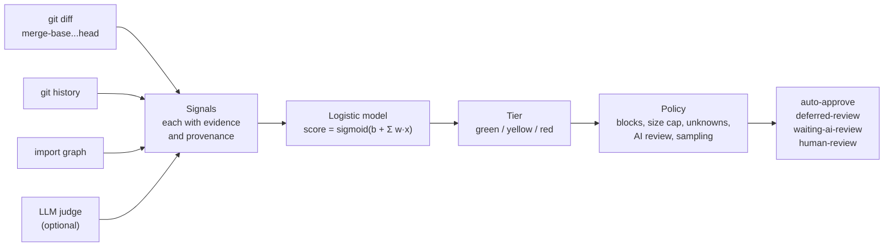

# opendrs: PR blast radius analyzer and risk score for safe auto-approval

**A calibrated 0-1 risk score for every pull request, so AI-reviewed, low-blast-radius PRs can be
auto-approved into the merge queue while risky ones still wait for a human.**

[](https://github.com/marketplace/actions/opendrs-diff-risk-score)
[](https://github.com/error-path/opendrs/actions/workflows/ci.yml)
[](LICENSE)

AI agents now write and review code faster than people can read it, so human review has become
the bottleneck. Most pull requests are low risk, and a few cause most incidents. opendrs measures
each PR's **blast radius** and risk: what the change touches, how many files depend on it, the
history of the files it changes, author experience, missing tests and critical paths. It turns
that into a 0-1 score using signals from your own git history. A team then sets a policy.
For example, a PR that scores below 0.3 and has passed an AI review (Claude, CodeRabbit, Copilot
or any check run) is approved and sent to the merge queue or auto-merge. Riskier PRs still wait
for a human. The approach follows Meta's Diff Risk Score (DRS); opendrs is an independent,
open-source implementation that runs in any git repository, with no service to host.

**Contents:** [Install](#install) · [Quick start](#quick-start) · [How it works](#how-it-works) ·
[Features](#features) · [Results](#results) · [CLI and MCP](#cli-and-mcp) ·
[Documentation](#documentation) · [Limitations](#limitations) ·
[Compared with other tools](#compared-with-other-tools) · [Prior art](#prior-art-and-credits)

## Install

| Use it as | Command | Details |
|---|---|---|
| GitHub Action | `uses: error-path/opendrs@v0` ([Marketplace](https://github.com/marketplace/actions/opendrs-diff-risk-score)) | Comments, labels and, optionally, approves and merges. [GitHub Action reference](docs/github-action.md) |
| CLI | `npx @error-path/opendrs score` | [CLI, MCP server, Claude Code plugin and agent skill](docs/cli-and-mcp.md) |
| MCP server (any agent) | `npx -y @error-path/opendrs mcp` | Tools: `score_diff`, `explain_file_risk`, `list_hotspots`, `suggest_reviewers` |
| Claude Code plugin (skill plus MCP server) | `/plugin marketplace add error-path/opendrs`, then `/plugin install opendrs@opendrs` | |
| Agent skill (Claude Code, Cursor, Codex and others) | `npx skills add error-path/opendrs` | [`skills/opendrs/SKILL.md`](skills/opendrs/SKILL.md) |
| Docker (MCP server over stdio) | `docker build -t opendrs . && docker run -i --rm -v "$PWD:/repo" opendrs` | Mount the repository to score at `/repo` |

Website and guides: [error-path.github.io/opendrs](https://error-path.github.io/opendrs/).

## Quick start

Score your current branch against the default branch. No configuration or API key is needed:

```sh
npx @error-path/opendrs score
```

You get a score, a tier (green, yellow or red), the signals that drove it with their evidence,
and the policy decision. `--json` prints the full result, and `--fail-above 0.6` makes the
command exit 1 above a threshold.

To score every pull request, add `.github/workflows/opendrs.yml` (or run `npx @error-path/opendrs init`):

```yaml
name: opendrs
on:
  pull_request:
    types: [opened, synchronize, reopened, ready_for_review, labeled, unlabeled]
permissions:
  contents: read
  pull-requests: write
  checks: read
jobs:
  opendrs:
    runs-on: ubuntu-latest
    steps:
      - uses: actions/checkout@v5
        with:
          fetch-depth: 0   # required: the score reads past commits and authors
      - uses: error-path/opendrs@v0
```

This only comments and labels. Approval is off until you turn it on in `.opendrs.yml` on your
default branch; see [how to auto-approve low-risk PRs](docs/auto-approve.md) and the
[GitHub Action reference](docs/github-action.md).

## How it works



1. **Signals.** Each signal provider reads the diff, the history and the import graph and emits
   features: size, how spread out the change is, past fixes and reverts in the touched files,
   the author's experience with them, complexity, blast radius (transitive dependents), critical
   paths and missing tests. Every signal records how it was obtained (`observed`, `derived`,
   `inferred` or `unknown`) and the evidence behind it. [All signals](docs/signals.md)
2. **Model.** A logistic regression turns the features into a probability. Each signal's
   contribution `w·x` is reported, so you can see why a PR scored what it did. Out of the box the
   weights are hand-set priors; `opendrs calibrate` fits them to your repository.
   [Calibration and backtesting](docs/calibration.md)
3. **Tiers.** The score maps to green, yellow or red, mirroring Meta's gates. Thresholds can be
   absolute scores or percentiles of your own history.
4. **Policy.** Ordered rules turn the score into a decision. [Policy and safety rails](docs/policy.md)

## Where opendrs sits in your PR flow

A PR now often gets two rounds of AI review before a human looks at it. Those rounds catch local
defects: typos, missing null checks, an obvious off-by-one. By the time a human opens the PR, that
work is done, and what is left is a design and architecture judgment call made with less context
than before. opendrs is built for that moment: it tells the final human how much attention the PR
needs and names up to five architecture and history facts — a new import between modules, a broken
public contract, a file that usually changes with one the PR didn't touch — that neither the
editor nor the AI review comments showed. See [the captain brief](docs/captain.md).

## Features

| Feature | What it does | Default | Docs |
|---|---|---|---|
| Risk signals | Size, spread, file history, author experience, complexity, blast radius, critical paths, tests, language | on | [Signals](docs/signals.md) |
| Calibration and backtest | Fit the weights to your history and measure capture at 5 / 10 / 50 % gated | run on demand | [Calibration](docs/calibration.md) |
| Hard blocks and safety rails | Blocked paths, binaries, submodules, self-modification guard, sampling, stale-approval checks | on | [Policy](docs/policy.md) |
| Auto-approval | Approve green PRs after your AI review passes, then auto-merge or the merge queue | off | [Auto-approve guide](docs/auto-approve.md) |
| LLM judge | Classifies every hunk into safe or risk categories; can only raise the score | off | [LLM judge](docs/llm-judge.md) |
| `requireSafe` gate | Auto-approve only when the judge calls every hunk safe with enough confidence | off | [LLM judge](docs/llm-judge.md) |
| Per-source policy | Human, bot or AI-agent PRs get their own stricter green, daily cap and track record | off | [Policy](docs/policy.md) |
| Deferred review | A PR just above green lands now and gets a post-merge review | off | [Policy](docs/policy.md) |
| Landing delay | An eligible PR waits before approval, so a human can veto | off | [Policy](docs/policy.md) |
| Freeze windows | Suspend or tighten auto-approval on weekends or peak dates | off | [Policy](docs/policy.md) |
| Content blocklist | Regexes on added lines send a PR to a human | off | [Configuration](docs/configuration.md) |
| Reviewer assignment | One of the top three experts is asked to review risky PRs | on in the Action | [Policy](docs/policy.md) |
| Hotspots | Rank files by risk at rest | run on demand | [CLI and MCP](docs/cli-and-mcp.md) |
| Review brief | Ranks hunks to read first, fixed check questions, safe-to-skim list, hard-rule reasons — recipes for claude-code-action, Bugbot, CodeRabbit (limited), Copilot and Codex (paste) | on | [LLM reviewers](docs/llm-reviewers.md), [CLI and MCP](docs/cli-and-mcp.md) |
| Pre-PR self-check | Lists the ids an author agent should fix or explain before opening the PR; opendrs reads the verdicts back from the head commit and adds one advisory line, never part of the gate | off | [Self-check recipe](docs/llm-reviewers.md#self-check-before-you-open-the-pr) |
| Verification pass | One batched LLM call re-checks every captain fact, review-first hunk and check with fresh context and keeps, drops or downgrades each one; never changes the score, tier or policy | off | [Verification pass](docs/verification.md) |
| Incident feedback | `opendrs feedback` records incidents for calibration | run on demand | [Calibration](docs/calibration.md) |

Every setting lives in `.opendrs.yml`, read from the base branch so a PR cannot loosen its own gate:
[configuration reference](docs/configuration.md).

## Results

| Benchmark | Result | Details |
|---|---|---|
| ApacheJIT (15 Apache Java projects, official 2017–2019 test years, `apache/hadoop` left out because it has no positive labels) | Calibrated opendrs: AUC 0.823; catches 67 % of buggy commits in its riskiest 30 %, on par with a regression on the classic JIT metrics (0.821, 66 %) | [Results on ApacheJIT](docs/calibration.md#results-on-apachejit) |
| ApacheJIT with the LLM judge (Claude Sonnet 5, 800 sampled test commits) | At confidence 8, the commits the judge calls all-safe are buggy at 5.3 %, against a 25.5 % base rate | [With the structured LLM judge](docs/calibration.md#with-the-structured-llm-judge) |
| 27 public repositories (calibrate, then backtest) | Calibration beat the default priors on held-out commits in all nine repositories of the first run | [Benchmark results](docs/results.md) |

## CLI and MCP

| Command | What it does |
|---|---|
| `opendrs score` | Score `merge-base(base, head)..head` |
| `opendrs explain <file>` | A file's history, fixes, authors, dependents and path policy |
| `opendrs hotspots` | Rank files by risk at rest |
| `opendrs calibrate` / `opendrs backtest` | Fit the model to your history; compare default and calibrated models |
| `opendrs feedback` | Record an incident in `.opendrs/incidents.jsonl` |
| `opendrs init` | Write a commented `.opendrs.yml` and a comment-only workflow |
| `opendrs mcp` | Run the MCP server |

Flags, exit codes, MCP tools and the agent skill: [CLI, MCP server, Claude Code plugin and agent skill](docs/cli-and-mcp.md).

## Documentation

| Page | Read it when you want to |
|---|---|
| [Auto-approve low-risk PRs](docs/auto-approve.md) | set up a risk-based approval gate step by step |
| [GitHub Action reference](docs/github-action.md) | look up inputs, outputs, permissions, branch rules and the scheduled sweep |
| [Policy and safety rails](docs/policy.md) | know exactly why a PR was or was not approved |
| [Configuration reference](docs/configuration.md) | change `.opendrs.yml` |
| [Risk signals](docs/signals.md) | see what opendrs measures and how |
| [What is the blast radius of a PR?](docs/blast-radius.md) | understand blast radius |
| [LLM judge](docs/llm-judge.md) | turn on the optional LLM judge or the `requireSafe` gate |
| [Feeding the review brief to an LLM reviewer](docs/llm-reviewers.md) | get opendrs's findings in front of Claude Code, claude-code-action, Bugbot, CodeRabbit, Copilot or Codex |
| [The captain brief](docs/captain.md) | know what the final human reviewer sees: priority, reviewer, and the architecture and history facts |
| [Verification pass](docs/verification.md) | turn on an LLM re-check of the brief's facts before a human reads them |
| [Calibration and backtesting](docs/calibration.md) | fit the model to your repository and choose thresholds |
| [Benchmark results](docs/results.md) | see how opendrs ranks risk on public repositories |
| [Experiments](docs/experiments.md) | see what we tried and what did not work |
| [CLI, MCP server, Claude Code plugin and agent skill](docs/cli-and-mcp.md) | run opendrs locally or from an agent |
| [Known limitations](docs/limitations.md) | know what opendrs cannot see |
| [Compared with other tools](docs/alternatives.md) | choose between opendrs and other PR risk tools |
| [CHANGELOG](CHANGELOG.md) | see what changed in each release |

## Limitations

- **The default weights are not fit to your code.** Run `backtest` before trusting them, and
  `calibrate` when you have enough history.
- **Labels are proxies** for incidents, and small repositories give unstable numbers.
- **The score is not a code review.** It estimates the chance of an incident, not whether the
  change is correct.

The full list: [known limitations](docs/limitations.md).

## Compared with other tools

| If you want | Use |
|---|---|
| A risk gate that approves or merges low-risk PRs, measured on your own history, with no service to host | opendrs |
| An LLM's judgment of each PR as the gate | PR-Agent's auto-approval, Merge Steward or MergeShield Risk Check; opendrs's optional LLM judge can only raise the score |
| Approval inside Cursor's cloud on a team plan | Cursor approval agents |
| Review comments on the code | An AI reviewer (Claude Code, CodeRabbit, PR-Agent), with opendrs running after it |

The full comparison, with how each tool scores and where it runs, is at
[error-path.github.io/opendrs/alternatives.html](https://error-path.github.io/opendrs/alternatives.html).

## Prior art and credits

- **Meta's Diff Risk Score.** [Diff Risk Score: AI-driven risk-aware software development](https://engineering.fb.com/2025/08/06/developer-tools/diff-risk-score-drs-ai-risk-aware-software-development-meta/)
  (Engineering at Meta, 2025) and Abreu et al., [Moving Faster and Reducing Risk: Using LLMs in
  Release Deployment](https://arxiv.org/abs/2410.06351) (2024). The feature set, the tiered gates and
  the capture-at-X %-gated metric come from this work. opendrs is not affiliated with Meta.
- **Meta's RADAR.** Adams et al., [Automating Low-Risk Code Review at Meta](https://arxiv.org/abs/2605.30208)
  (2026): the structured LLM reviewer with safe and risk categories, per-source policy (daily caps,
  track record), deferred review, the landing delay and the content blocklist follow this paper.
  Related Meta work behind `hotspots` and reviewer assignment: Mockus et al., "Metrics Driven
  Reengineering and Continuous Code Improvement at Meta" (ASE 2025); Paraspatki et al., "Code
  Reviewer Recommendation for High Risk Diffs at Scale" (FSE Companion 2026); Rigby et al.,
  [Improving Code Reviewer Recommendation](https://arxiv.org/abs/2312.17169) (TOSEM 2025).
- **Benchmarks and peers.** Keshavarz and Nagappan, [ApacheJIT](https://arxiv.org/abs/2203.00101)
  (MSR 2022), the dataset `bench/apachejit/` scores; Sayedsalehi, Rigby and Mockus,
  [DRS-OSS](https://arxiv.org/abs/2511.21964) (2025), the open-source LLM counterpart whose numbers
  the benchmark quotes.
- **Just-in-time defect prediction and SZZ.** Mockus and Weiss, "Predicting risk of software
  changes" (2000); Śliwerski, Zimmermann and Zeller, "When do changes induce fixes?" (2005); Kamei
  et al., "A large-scale empirical study of just-in-time quality assurance" (2013). The
  change-level features and the SZZ-style labelling follow this literature.
- **REA** ([morluto/rea](https://github.com/morluto/rea)). opendrs adopts REA's evidence-first
  method: every conclusion is marked observed, derived, inferred or unknown, and unknown is never
  treated as safe. It also follows REA's layering of domain types, providers, a shared engine and
  thin adapters.

## License

[MIT](LICENSE)
